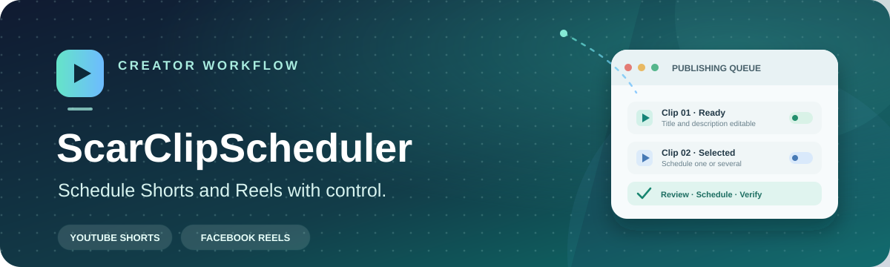
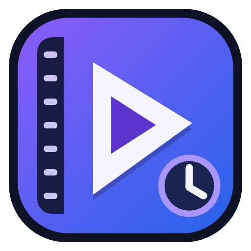

# ScarClipScheduler

**A Windows desktop scheduler for YouTube Shorts and Facebook Page Reels.**

[Website](https://sifat-jaman-13.github.io/youtube-shorts-facebook-reels-scheduler/) · [Download latest release](https://github.com/sifat-jaman-13/youtube-shorts-facebook-reels-scheduler/releases/latest) · [Features](#features) · [Install](#install-the-windows-exe) · [API setup](#connect-your-platforms) · [Usage](#manage-your-clip-queue) · [Troubleshooting](#troubleshooting)

---

## Overview

ScarClipScheduler takes rendered MP4 clips and their matching TXT metadata, lets you review every title and description, then schedules selected clips to a connected YouTube channel and one or more Facebook Pages.

It uses the official Google YouTube Data API and Meta Graph API. It does not simulate browser clicks, scrape pages, or bypass platform authorization. Platform permissions, quotas, account eligibility, and App Review decisions still apply.

## Features

- **Modern desktop interface:** dark navy workspace, violet/blue accents, readable queue styling, and a branded app icon.
| Feature | What it does |
|---|---|
| One publishing queue | Manage YouTube Shorts and Facebook Page Reels from one window |
| Multi-Page Facebook | Publish to multiple selected Pages and track each Page independently |
| Select individual videos | Click one row to select a single clip; Ctrl/Shift-click to select several |
| Select all / unselect all | Quickly change the selected set |
| Delete from list | Remove selected entries and their local queue history without deleting MP4/TXT files |
| Editable metadata | View each video's title and description in the list; edit the selected video's fields before upload |
| TXT pairing | Import the first non-empty TXT line as the title and the remaining text as the description |
| Scheduled publishing | Choose a start time and posting interval |
| Publication verification | Check the platform-side status after the scheduled time |
| Safe file organization | Separate scheduled, uploaded, pending, and failed local files |
| Local-first data | Keep queue data and authorization tokens in your Windows user profile |

### Selection and scheduling behaviour

- **Click one video row** to select that single clip and load its title/description into the editor.
- Use **Ctrl-click** or **Shift-click** to select multiple videos.
- **Select all** selects every detected queue entry. **Unselect all** clears the selection.
- **Delete from list** removes only the selected database entries. The local video and TXT files remain on disk. Existing posts already accepted by a platform are not cancelled.
- When one or more rows are selected, **Schedule queue** operates on that selection only. When nothing is selected, the entire queue is used.
- Double-click a row to focus its title editor. Click **Save metadata** to save the title and description to the local queue database.

## Install the Windows EXE

**Recommended:** download the EXE from the repository:

[Download ScarClipScheduler.exe](https://github.com/sifat-jaman-13/youtube-shorts-facebook-reels-scheduler/raw/refs/heads/main/dist/ScarClipScheduler.exe)

The EXE is a small Windows terminal bootstrapper. It embeds the application source and requirements file; it does not bundle a private Python runtime or platform credentials.

1. Download ScarClipScheduler.exe.
2. Double-click it. A terminal window opens and checks for Python 3.11 or newer.
3. If Python 3.12 is not found, the bootstrapper attempts a per-user installation with Windows Package Manager (winget). It does not require an administrator account when the package manager supports user scope.
4. It creates an isolated .venv under %LOCALAPPDATA%\Programs\ScarClipScheduler and installs the packages from requirements.txt over the internet.
5. It launches ScarClipScheduler. Keep the terminal open while the desktop app is running.

The EXE is currently unsigned; Windows SmartScreen may show a warning on first launch. Only download it from this repository and review the source/build workflow if Windows asks you to verify the publisher.

The setup is repeated only when the embedded app version changes or required imports are missing. Your queue, settings, Google tokens, Meta tokens, and logs remain in:

~~~text
%LOCALAPPDATA%\ScarClipScheduler\
~~~

The installed app source and virtual environment are stored separately:

~~~text
%LOCALAPPDATA%\Programs\ScarClipScheduler\
~~~

### If winget is unavailable

Install the official Python 3.12 Windows installer from [python.org](https://www.python.org/downloads/windows/). Enable the Python launcher (and, if offered, **Add Python to PATH**). Run the ScarClipScheduler EXE again.

### Developer / source install

The repository includes a batch launcher for running from source:

~~~powershell
git clone https://github.com/sifat-jaman-13/youtube-shorts-facebook-reels-scheduler.git
cd youtube-shorts-facebook-reels-scheduler
.\Start ScarClipScheduler.bat
~~~

The batch launcher creates .venv, installs requirements.txt, and starts app.py. Or run the setup manually:

~~~powershell
py -3.11 -m venv .venv
.\.venv\Scripts\Activate.ps1
python -m pip install --upgrade pip
python -m pip install -r requirements.txt
python app.py
~~~

## Connect your platforms

You do not paste API keys into this README or into ChatGPT. Create your own credentials in the official developer dashboards and enter them only in ScarClipScheduler on your own PC.

### YouTube Shorts — Google Cloud OAuth

ScarClipScheduler uploads videos and reads the connected channel, so it uses **OAuth 2.0 Desktop App credentials**. A simple Google API key is not enough to authorize uploads or access your private channel.

| Credential / setting | Where to get it | What to do |
|---|---|---|
| Google Cloud project | [Google Cloud Console](https://console.cloud.google.com/) | Create a project or select an existing one |
| YouTube Data API v3 | APIs & Services → API Library | Search for YouTube Data API v3 and enable it |
| OAuth consent / Google Auth Platform | Google Cloud Console → Google Auth Platform | Configure app name, audience, and contact details; add your Google account as a test user while testing |
| OAuth Client ID | Google Auth Platform → Clients / APIs & Services → Credentials → Create credentials | Choose Desktop app |
| Client JSON | OAuth client entry | Download the JSON file; keep it private |

**Connect in the app**

1. Open **Connections → YouTube**.
2. Browse to the downloaded Desktop App client JSON file.
3. Click **Connect YouTube**.
4. Sign in to the Google account that owns the intended channel and approve the requested YouTube permissions.
5. Check that the connected channel name shown by the app is correct.

Requested OAuth scopes:

- **youtube.upload** — upload/manage the channel's videos.
- **youtube.readonly** — read the authenticated channel/video status.

**Testing-mode token expiry:** Google notes that refresh tokens for External OAuth apps left in Testing can expire after seven days when non-basic scopes are requested. For ongoing use, review Google's publishing and verification requirements and use the appropriate consent-screen publishing status. See [Google OAuth 2.0 documentation](https://developers.google.com/identity/protocols/oauth2#expiration).

Official guide: [YouTube Data API authorization](https://developers.google.com/youtube/data/guides/authentication).

### Facebook Page Reels — Meta Developers

The Facebook integration uses a Meta developer app and obtains Page access tokens through the in-app OAuth flow. You do not need to manually paste a Page token into the queue.

| Credential / setting | Where to get it | What to do |
|---|---|---|
| Meta App ID | [Meta for Developers](https://developers.facebook.com/apps/) → your app → App settings → Basic | Copy the App ID |
| Meta App Secret | The same App settings → Basic page | Reveal and copy it; keep it private |
| Business Portfolio ID | [Meta Business Suite](https://business.facebook.com/) → Business settings → Business info | Copy the Business Portfolio ID that owns the Pages |
| OAuth redirect URI | Meta app → Facebook Login / OAuth settings | Add the exact URI shown below |
| Page access | Facebook account and Business Portfolio | The connecting account must have permission to create Page content |

Configure this exact redirect URI in the Meta app:

~~~text
http://localhost:8765/callback
~~~

The current app requests these permissions:

| Permission | Purpose |
|---|---|
| **pages_show_list** | List Pages available to the connected account |
| **pages_manage_posts** | Create and schedule Page content |
| **pages_read_engagement** | Read Page publishing/status information |
| **business_management** | Discover Pages belonging to the selected Business Portfolio |

**Connect in the app**

1. Open **Connections → Facebook**.
2. Enter the Meta App ID, App Secret, and Business Portfolio ID.
3. Click **Connect & Load Business Pages**.
4. Complete the Facebook login/consent page in your browser.
5. Select the Pages that should receive each Reel.

The app stores the credentials and access tokens locally in your Windows user profile. Never share the App Secret or tokens. Meta may require App Review and Advanced Access for people who are not assigned a role in your developer app. See [Meta App Review](https://developers.facebook.com/docs/resp-plat-initiatives/app-review/introduction/) and the [Page API reference](https://developers.facebook.com/docs/graph-api/reference/page/).

## Prepare and manage clips

### Expected folder structure

StreamSnip AI and other editors can export a matching TXT sidecar beside each MP4:

~~~text
clips/
  highlight_001.mp4
  highlight_001.txt
  highlight_002.mp4
  highlight_002.txt
~~~

The first non-empty line in the TXT file is used as the title. Remaining lines become the description. Example:

~~~text
The Most Unexpected Comeback

An incredible moment from the stream.
#Shorts #Gaming #Clips
~~~

### Queue workflow

1. Choose the folder containing your rendered MP4 clips.
2. Click **Scan clips**.
3. Review the detected videos and their title/description columns.
4. Click a single video to edit it, or select a group with Ctrl/Shift-click.
5. Use **Save metadata** to apply the selected video's edits.
6. Choose YouTube, Facebook, or both; select the Facebook Pages; set the first post time and interval.
7. Confirm you have the rights to publish the footage.
8. Select the videos you want scheduled, then click **Schedule queue**. Leave the list unselected to schedule the whole queue.

### Delete from list — important distinction

**Delete from list is not file deletion.** It removes the selected clip records from ScarClipScheduler's local database and removes their per-Page queue history. The actual MP4/TXT files remain untouched in the source folder.

If a post was already accepted by YouTube or Facebook, removing its local record does not cancel that platform-side schedule. The confirmation dialog displays how many selected entries have accepted destinations before it removes them.

## Scheduling and status

- The app uploads/schedules through the official platform APIs.
- An accepted request is **Scheduled**, not proof the post is already public.
- Scheduled YouTube videos are initially uploaded as private with a publishAt time.
- The app checks status after the due time and has an automatic background verification cycle while open.
- If Windows is off at the publication time, a schedule already accepted by the platform can still publish; local status verification resumes when the app is opened again.
- Accepted MP4/TXT pairs may be moved into the schedule folder. Failed, pending, and partial items remain reviewable.
- The **You can delete these clips now** folder is a manual-review location. The app does not automatically delete videos.

### Limits and format checks

| Platform | Application-side behaviour |
|---|---|
| YouTube | The app spaces upload requests around the configured project quota and schedules the video with publishAt |
| Facebook Page Reels | The app spaces submissions per Page and checks the Reel format before upload |
| Facebook format | Conservative pre-check expects vertical 9:16 video and 4–60 seconds |
| Scheduled status | Platform acceptance is tracked separately from later confirmed publication |

Quotas, limits, and publishing eligibility may vary by project, account, and platform policy. Check your own developer dashboards when an API request is rejected.

## Local data and security

App data is stored under:

~~~text
%LOCALAPPDATA%\ScarClipScheduler\
~~~

This folder may contain the queue database, settings, Google OAuth client information, YouTube refresh tokens, Meta App Secret, Page access tokens, and logs.

- Never commit OAuth JSON files, tokens, App Secrets, databases, or logs.
- Do not paste credentials into GitHub issues, screenshots, support messages, or chats.
- Restrict access to your Windows user account and use disk encryption where appropriate.
- If a credential is exposed, revoke or rotate it in the relevant Google or Meta dashboard.
- The repository .gitignore excludes local state and credential files.

## Test and build from source

Install development dependencies and run the regression suite:

~~~powershell
python -m pip install -r requirements.txt
python -m py_compile app.py
python -m unittest discover -s tests -v
~~~

Build the single-file Windows terminal bootstrapper on Windows with .NET Framework 4.x:

~~~powershell
.\build_windows_exe.ps1
~~~

The script compiles bootstrapper/Program.cs with the Windows C# compiler and embeds app.py plus requirements.txt into dist/ScarClipScheduler.exe. Python and pip packages are installed by the EXE at first launch; they are not bundled into it.

## Project structure

~~~text
youtube-shorts-facebook-reels-scheduler/
├── app.py
├── requirements.txt
├── Start ScarClipScheduler.bat
├── build_windows_exe.ps1
├── bootstrapper/
│   └── Program.cs
├── assets/
│   └── scarclipscheduler-banner.svg
├── dist/
│   └── ScarClipScheduler.exe
├── tests/
│   └── test_scheduler.py
└── .github/
    └── workflows/
        ├── tests.yml
        └── build-exe.yml
~~~

## Troubleshooting

| Problem | What to check |
|---|---|
| EXE cannot install Python | Install Python 3.12 from [python.org](https://www.python.org/downloads/windows/) or make sure Windows Package Manager (winget) is available |
| EXE package installation fails | Check internet access, proxy settings, and whether pip install -r requirements.txt succeeds |
| YouTube authorization fails | Check the Desktop OAuth client JSON, consent-screen test users, enabled YouTube Data API v3, and connected Google account |
| YouTube token stops refreshing | Review Google's OAuth publishing status and the seven-day testing-token rule |
| Facebook Pages do not load | Check App ID, App Secret, Business Portfolio ID, Page access, and business_management / pages_show_list permissions |
| Facebook permission error | Check pages_manage_posts, pages_read_engagement, Page content task access, and Meta App Review / Access level |
| Facebook OAuth callback fails | Ensure port 8765 is available and the redirect URI matches exactly |
| Reel is rejected | Check vertical 9:16 format, video duration, Page permissions, and the Meta API response |
| Upload seems stalled | Keep the app open, check internet access, then inspect %LOCALAPPDATA%\ScarClipScheduler\app.log |

## Platform documentation

- [YouTube Data API authorization](https://developers.google.com/youtube/data/guides/authentication)
- [YouTube Data API upload guide](https://developers.google.com/youtube/data/guides/uploading_a_video)
- [Google OAuth 2.0](https://developers.google.com/identity/protocols/oauth2)
- [Meta Pages API](https://developers.facebook.com/docs/graph-api/reference/page/)
- [Meta Page publishing](https://developers.facebook.com/docs/graph-api/reference/page/feed/)
- [Meta App Review](https://developers.facebook.com/docs/resp-plat-initiatives/app-review/introduction/)

---

**Created by Sifat Jaman**

Built with assistance from **ChatGPT (OpenAI)**.

ScarClipScheduler is a desktop publishing utility. Users remain responsible for rights, permissions, platform policies, and the content they schedule.

